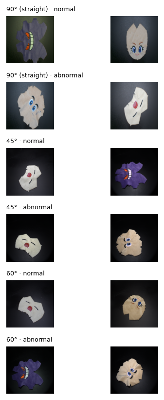
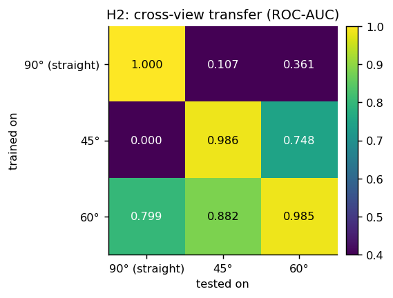

# Multi-view embroidery defect detection

F21DL group coursework, group PG18, Heriot-Watt University Dubai.

We ask whether photographing embroidered fabric from more than one angle makes it easier for a
model to separate good embroidery from defective embroidery. On this dataset the answer is no,
and the code and tables here are what that answer rests on.

**Report:** [`report/report.pdf`](report/report.pdf)

|  |  |
|---|---|
| Task | binary classification, normal against abnormal embroidery |
| Data | 1,080 RGB images, four garments, three camera angles |
| Models | seven classical learners, an MLP, a CNN, a convolutional VAE |
| Result | H1 rejected, H2 supported |

## The question

Manual inspection is slow and people get tired, and defects are easy to miss depending on how
the light hits them: a bit of shine shows up at 45 degrees and disappears straight on. So we
ask:

> Does giving a model more than one viewing angle improve defect detection compared with the
> straight-on 90 degree view alone?

Two hypotheses come out of that:

- **H1:** multiple viewing angles improve detection compared with a single angle.
- **H2:** the angles are not equally useful. Some are harder than others.

The plan is the one we pitched in week 4. The data turned out to be messier than its own
documentation suggests, so the splitting took more care than we expected.

## The data

| What | How many |
| --- | --- |
| Images | 1,080 |
| Normal | 492 |
| Abnormal | 588 |
| 90 degrees (straight) | 313 |
| 45 degrees | 377 |
| 60 degrees | 390 |
| Physical samples | 4 |
| Groups (sample + defect type) | 35 |

A group is one physical sample with one defect type, and every photo of that defect shares a
group id. That matters for splitting: two frames of the same defect taken a second apart are
almost identical, so if one lands in training and the other in test the model looks far better
than it is. All splits are made on groups, never on images.



*Two frames per view and class. The normal 90 degree images come from normal-only groups, which
are separate designs from the defect groups. That overlap between class and design is one of the
caveats in the discussion.*

Three properties of this dataset shape the whole project:

1. There are only four physical samples. We are testing generalisation to another defect on the
   same four garments, not to new garments.
2. 16 of the 35 groups contain both normal and abnormal images, so a group is not a class.
3. The split files shipped with the dataset reassign groups between view cases, 10 of 35 groups
   move between `straight_only` and `straight_60`. Comparing "straight only" with "straight plus
   45" on those files would compare different test sets while claiming to compare views. We
   build one partition and derive all three view conditions from it.

There is also an auxiliary YOLO folder with 954 annotated images and 1,883 polygons across four
defect classes. Those are annotated copies of abnormal images from the main set, not extra
images, so they are not part of the 1,080.

## What we did

- 88 features per image: colour and HSV statistics, brightness and contrast, GLCM texture, local
  binary patterns, edge strength, a gradient direction histogram, FFT band energies and quadrant
  brightness.
- k-means and a Gaussian mixture fitted with EM, to see whether defects separate on their own.
  Silhouette and Davies-Bouldin for the internal view, ARI and NMI against the label only to
  interpret the clusters afterwards.
- Seven classical learners: decision tree, Gaussian naive Bayes, logistic regression,
  perceptron, k-NN, random forest and gradient boosting. The brief asks for three.
- An MLP on the same features, and a small CNN on the images with augmentation, early stopping
  and Grad-CAM.
- A VAE trained on normal images only and scored by reconstruction error, which covers the
  generative side of the brief and gives an unsupervised check on the same question.
- H1 tested on the same 90 degree test images in all three view conditions, so the only thing
  that changes is the training data, with McNemar's exact test on the paired predictions. H2 is a
  train-angle by test-angle transfer matrix.

## Results

Every number below comes from the pipeline and sits in `results/tables/`.

| View condition | classical, paired F1 | CNN F1 | CNN AUC |
| --- | --- | --- | --- |
| 90 only | 1.00 | 0.93 | 1.000 |
| 90 + 45 | 0.66 | 0.65 | 0.864 |
| 90 + 60 | 1.00 | 0.85 | 0.929 |

- **Single-view detection works** on held-out defect groups. View-specific models reach F1 1.00
  at 90 degrees, 0.93 at 45 and 0.84 at 60.
- **Extra angles do not help.** On the same 90 degree test images, logistic regression falls from
  F1 1.00 to 0.66 once 45 degree images enter training (McNemar p < 0.001), and 90+60 does not
  move it. The CNN shows no significant change when the 45 degree view is added (p = 0.58) or the
  60 degree view (p = 0.22). H1 is rejected.
- **The angles are not interchangeable.** Training on 45 and testing on 90 gives AUC 0.000, and
  90 to 45 gives 0.107, while own-view AUC sits between 0.986 and 1.000. H2 is supported.
- **Generalisation is partial and unstable.** Holding out one whole garment gives mean F1 0.755
  against 0.789 for the group split, but the spread across the four garments runs from 0.478 to
  0.974.
- **The VAE is a competent detector** (AUC 0.891, F1 0.821) with no defect labels during
  training: reconstruction error alone separates the two classes.
- **Lighting carries some of the signal** (AUC 0.603, accuracy 0.632 on brightness features
  alone), and the normal groups are separate patch designs, which is the most likely reason the
  supervised numbers look as high as they do.



*AUC in each cell for a model trained on one angle and tested on another. The diagonal is the model on its own view. A 45 degree model scores 0.000 on the 90 degree images, and a 90 degree model scores 0.107 on the 45 degree ones.*

The tables worth opening first:

- `baselines_metrics.csv`: seven learners, three view conditions, group bootstrap intervals.
- `mlp_metrics.csv` and `cnn_metrics.csv`: the neural networks on the same splits.
- `vae_anomaly.csv`: unsupervised anomaly detection.
- `h1_paired_common.csv` and `h1_mcnemar.csv`: the actual answer to H1.
- `h2_cross_view.csv`: which angle transfers worst.
- `cross_sample.csv`: the leave-one-garment-out check.
- `shortcut_probe.csv`: how much of the label is predictable from lighting alone.

`results/report_tables.md` collects all of them in one file, and
`results/tables/headline_numbers.json` holds the short version.

## Running it

Python 3.12, CPU is enough.

```bash
python -m venv .venv
.venv/Scripts/activate
pip install -r requirements.txt
pip install torch torchvision --index-url https://download.pytorch.org/whl/cpu

python -m src.run_all
```

`config.yaml` holds the exact settings behind the numbers in the report: 128 px input, seed 42,
25 CNN epochs, six validation groups and six test groups, 1000 bootstrap resamples. Change it and
the results drift away from the tables.

By default the dataset is read from `Vina-Embroidery/` in the repo root, which is git-ignored.
Elsewhere, pass `--dataset <folder containing raw/vai_theu/manifest.csv>`. A full run takes about
an hour on a CPU laptop, most of it in the CNN and the VAE. Stages can be run on their own:

```bash
python -m src.run_all --stages eda,clustering
python -m src.run_all --stages baselines
```

## Repository layout

```
src/        pipeline modules, roughly one per stage
results/    generated tables and figures, never hand edited
docs/       team contributions
report/     the submitted report
```

## Team

Kushik Siddapura Kumar (H00549226), Rachana Ramesh (H00549153), Shaik Shah Ali Safwan
(H00561860), Rohit Nadan Raju (H00534323), Abhishek Gowda Jayalakshmi (H00536176).

Who did what is in [`docs/CONTRIBUTIONS.md`](docs/CONTRIBUTIONS.md) and in the report appendix.

## Data credit

Vina-Embroidery dataset, Mendeley Data V2. If you reuse this code, cite the dataset record rather
than this repository.
